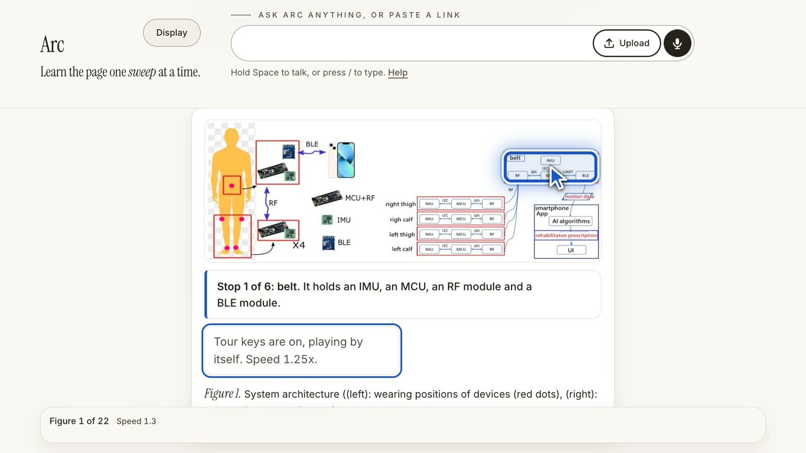
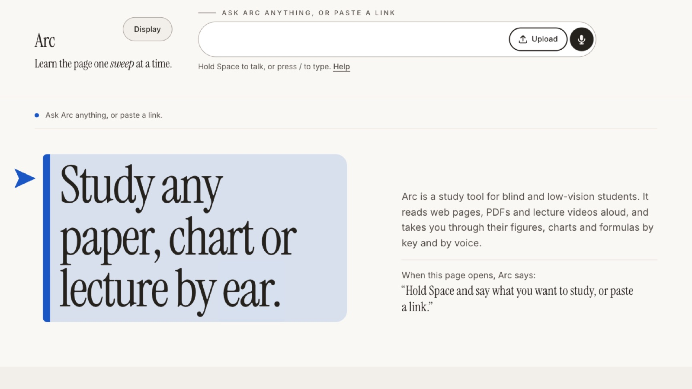
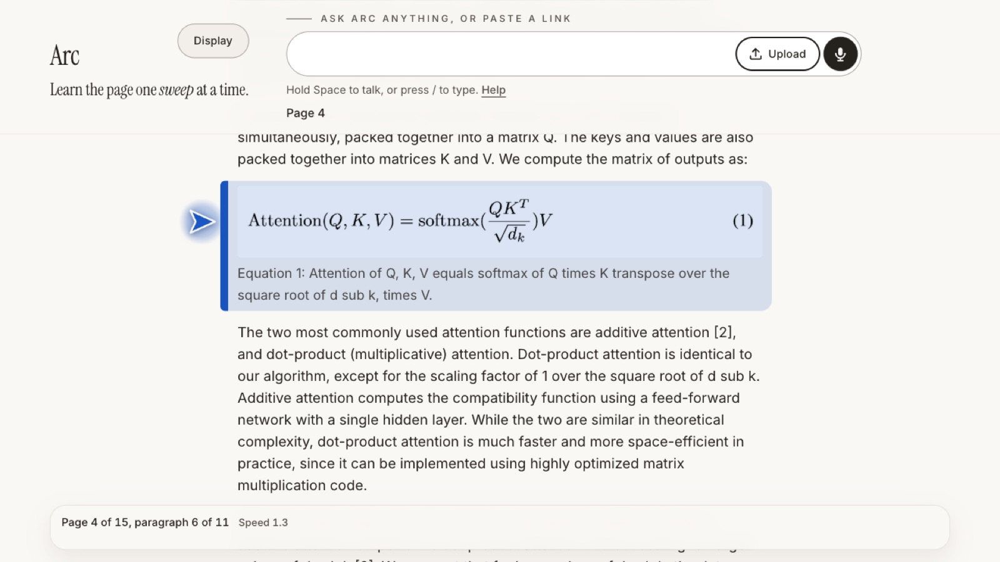
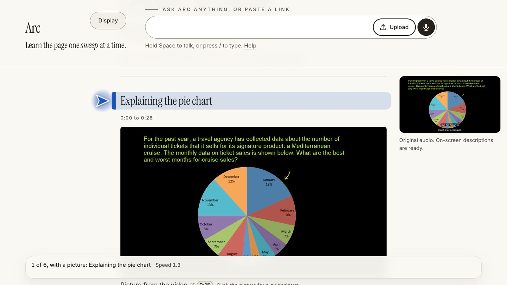
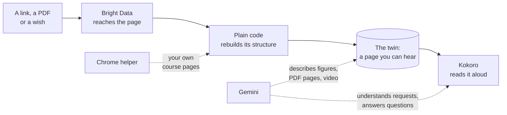

# Arc

[](https://github.com/vihuynh72/arc/actions/workflows/ci.yml)

**Learn the page one sweep at a time.**

Arc is a study tool for blind and low-vision students. Paste a link to a paper, a PDF or a lecture video and Arc rebuilds it as a page you can *hear*, then takes you through the parts other tools skip: the figures, the charts, the formulas and what is written on the board. You steer it with a few keys or your voice.



## Why

Ask a screen reader about a research figure and you often get one word: *"image."*

At least 2.2 billion people live with a vision impairment ([WHO](https://www.who.int/news-room/fact-sheets/detail/blindness-and-visual-impairment)), and the tools they are handed were built for text. But learning does not live only in text. It lives in the figure, the chart, the lecture and the formula, which is exactly where those tools go quiet. Arc starts there.

## What it does

| | |
|---|---|
| **A figure, toured part by part.** Arc moves a pointer to each part, rings it, and says where it is and what it does: *"Top right: belt. It holds an IMU, an MCU, an RF module and a BLE module."* Or move your own pointer and Arc tells you what is under it. | **A chart, heard as a curve.** Sweep across a chart and a tone rises and falls with the line. Then Arc reads the real numbers, computed in code from the chart's data. |
| **A lecture, with what is on screen.** Arc plays a YouTube or Khan Academy lecture and, in the gaps between the teacher's sentences, says what is on the board. | **A PDF, by voice.** *"Go to the Attention section."* Formulas are spoken as math: *"Attention of Q, K, V equals softmax of Q times K transpose over the square root of d sub k, times V."* |
| **No link? Just say what you want to learn.** *"I want to study biology"* gets a short narrowing question, then results read aloud. | **Ask the page anything.** Hold Space and ask. Arc answers from the page and says so when the page does not have the answer. |

It also reads pages behind a school login (Canvas and others) from your own browser, without ever seeing your password, and it has display profiles for low vision. See [private pages](docs/private-pages.md) and [display profiles](docs/display-profiles.md).

| The start page | A formula in a PDF | A lecture |
|---|---|---|
|  |  |  |

## Try it in five minutes

You need [Node.js](https://nodejs.org) 22 or newer and Chrome or Edge.

```bash
git clone https://github.com/vihuynh72/arc.git
cd arc
npm install
cp .env.example .env.local   # then fill in the keys (below)
npm run dev                  # open http://localhost:3000
```

Then paste a link and press Enter, or hold **Space** and say what you want to study. The start page also has one-click examples.

**Keys you need** (put them in `.env.local`, which is never committed):

| Key | What Arc uses it for |
|---|---|
| `GEMINI_API_KEY` | Understanding requests, answering questions aloud, describing figures, PDF pages and video ([get one](https://aistudio.google.com/apikey)) |
| `BRIGHTDATA_API_TOKEN` and its zones | Fetching pages that block ordinary requests, a remote browser, and search ([Bright Data](https://brightdata.com)) |

**No keys yet?** Run `ARC_OFFLINE=1 npm run dev` and open the example paper. The bundled demo paper and its prepared figure tour work with no keys at all, read by the local voice. New links, search and spoken questions need the keys.

The reading voice (Kokoro) runs on your own machine. It downloads once, a few hundred megabytes, the first time something is read.

## How to drive it

Everything can be done by key or by voice. Arc speaks for itself, so turn your screen reader off while you use it.

| To do this | Press | Or say |
|---|---|---|
| Read on, one part at a time | `Down` / `Up` | "next", "go back" |
| Jump by heading, figure, table, equation | `H`, `F`, `T`, `E` | "next heading", "go to figure 3" |
| Go to a section or page | | "go to the results", "section 3.2", "page 9" |
| Tour a figure | `Enter` on the figure | "tour this figure" |
| In a tour: pause, step, leave | `P`, arrows, `Escape` | "hold on", "next", "that's enough" |
| Hear it again | `R` | "say that again" |
| Faster or slower | `Cmd` or `Ctrl` + `Right` / `Left` | "faster", "slower" |
| Find a word | | "find sampling rate", then "next one" |
| Where am I? What is left? | | "where am I", "how much is left", "contents" |
| Ask a question | hold `Space` and speak | |
| Type instead | `/` | |
| Stop the voice | `Escape` | "stop" |
| Help | `?` | "help" |

The most basic commands also work in Spanish, French, German and Vietnamese ("siguiente", "arrête", "hilfe", "tiếp theo").

## How it works



| Piece | Its job | Why this piece |
|---|---|---|
| **Bright Data** | Fetches the page (Web Unlocker), runs a remote browser for pages that need one, and searches | Many study pages block ordinary requests |
| **Plain code** | Parses the page into headings, paragraphs, figures, tables and equations; computes every id, count and spoken direction | Structure must be exact, so no model touches it and nothing is invented |
| **Gemini** | Looks at figures, PDF pages and lecture video; decides what a spoken request means in about a third of a second; answers questions aloud, live | It sees what code cannot read |
| **Kokoro** | The reading voice, open source, running on the same machine as Arc | Free, private and fast |
| **Next.js** | The app: one Node process serving the pages and the voice socket | Long-lived connections, so nothing here is serverless |
| **Chrome helper** (`extension/`) | Reads a signed-in course page in your own browser and hands Arc only that page | Arc never gets a password, cookie or token |

A few rules the code holds itself to: a student is never left in silence; Arc acts on a spoken request only when it is confident, and otherwise asks; numbers spoken about a chart are computed in code from validated points; and on a quiz, Arc reads the questions but never gives, hints at or confirms an answer.

## Privacy

- No accounts, no logins, no stored student data.
- Private pages and uploaded PDFs live in the server's memory only, for about two hours, never on disk, in an address or in a log.
- A hosted copy keeps no recordings or transcripts of what visitors ask.

Details: [private pages](docs/private-pages.md).

## Running it for other people

Arc has a spend guard (every paid call is counted in dollars and Arc degrades gracefully as the day's budget runs out) and per-visitor limits. Both turn on in production. Everything about hosting, the voice options and every setting is in [docs/deploy.md](docs/deploy.md).

## Project layout

```
app/          pages and API routes
components/   the reading view, figure tours, the lecture player, the landing page
lib/          shared code: parse/ (page to twin), server/ (fetching, models, guards), client/ (voice, commands)
extension/    the Arc helper for Chrome (no build step)
fixtures/     the bundled demo pages and their hand-checked tours
scripts/      offline checks, the end-to-end suite, the simulated-student harness
server.ts     one Node process: Next plus the /ws/voice relay
```

Good files to open first: `lib/types.ts` (the shared data model), `lib/intent.ts` (the local command grammar), `lib/server/decide.ts` (the decision model), `lib/server/safeFetch.ts` (the one guard every outbound fetch goes through) and `components/FigureTour.tsx`.

## Checks

```bash
npm run selfcheck   # 46 offline check files: parsing, commands, tours, security rules. No keys, no network.
npm run e2e         # 18 scenarios in a headless Chrome against a running app. Offline by default; spends nothing.
npm run lint
npm run check      # the quick gate: typecheck, lint, selfcheck (about 25 s)
npm run factory    # the full gate: check, then build and run the browser suite on a scratch copy
```

Before a commit or a pull request, see [CONTRIBUTING.md](CONTRIBUTING.md).

`scripts/intent-eval.ts` measures how well Arc understands natural requests: 798 phrasings across nine situations, including long, polite and non-native ones.

## Where it stands, and how to help

Arc started at a one-day hackathon and has been rebuilt since. So far it has been exercised by simulated students (`scripts/blind/`): agents that use Arc only by keys and voice and judge it only by what they hear.

**If you are blind or have low vision, or you teach students who are, your feedback is the most valuable contribution this project can get.** Open an issue and tell us what worked and what did not.

Other good places to help:

- Arc's own spoken lines are English only; pages in other languages are read in their language, but Arc's prompts are not translated yet.
- More page layouts, more lecture sites, and better figure placement on diagrams it has not seen.
- Testing alongside real screen readers and in Safari and Firefox.

## Credits and licences

Arc's own code is released under the [MIT licence](LICENSE).

- Demo paper: "Development of Wearable Devices for Collecting Digital Rehabilitation/Fitness Data from Lower Limbs", Sensors 2024, 24(6), 1935, MDPI, [CC BY 4.0](https://www.mdpi.com/1424-8220/24/6/1935).
- Demo lecture: Khan Academy, "Reading pie graphs" (CC BY-NC-SA).
- The reading voice is [Kokoro](https://huggingface.co/hexgrad/Kokoro-82M) (Apache-2.0) through kokoro-js. Voices for some other languages use Piper models and **eSpeak NG, which is GPL-3.0**: if you redistribute Arc together with that component, its licence applies to it.
- Built with Google Gemini, Bright Data and Next.js.
- The screenshots in `docs/media/` show the demo paper's figure, a Khan Academy lecture frame and a page of "Attention Is All You Need" (arXiv:1706.03762); that material belongs to its authors and stays under its own terms.
